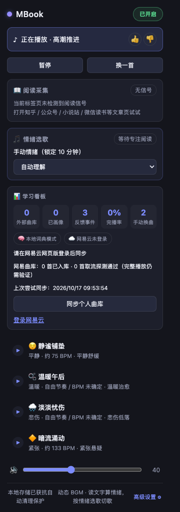
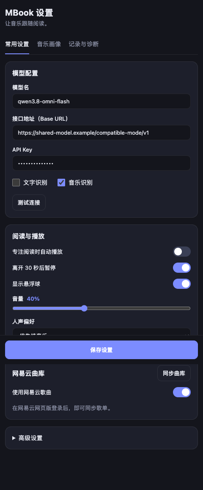

# MBook

**让阅读内容和用户状态实时驱动背景音乐的 Chrome 扩展。**

MBook 采集当前可见正文和阅读节奏，将内容映射为八维情绪，再从本地或个人曲库召回、排序并播放合适的音乐。它不是静态歌单播放器，而是一条持续运行的 **阅读感知 -> 情绪理解 -> 音乐推荐 -> 播放反馈** 闭环。

## 为什么值得看

- **真实产品闭环**：正文采集、八维情绪、候选召回、动态排序、播放控制和反馈学习均已接通。
- **复杂浏览器架构**：适配 Manifest V3 Service Worker 休眠，使用 Offscreen Document 维护唯一播放状态。
- **可解释推荐**：五路召回、八项评分、42 维特征，以及本地逻辑回归和 LinUCB 在线探索。
- **隐私优先**：正文不落库；模型能力采用 BYOK，密钥不进入网页 Content Script。
- **工程约束明确**：生产包保持在 10MB 内，并覆盖真实音频、Canvas 阅读页、CORS 降级和自动暂停/续播。

## 产品界面

| 播放与反馈 | 模型、阅读和曲库设置 |
| --- | --- |
|  |  |

## 工作流程


八维情绪包括：喜悦、悲伤、温柔、希望、恐惧、愤怒、神秘和庄严。各维独立评分，不强制总和为 1。

## 关键工程设计

| 问题 | 设计 |
| --- | --- |
| Service Worker 随时休眠 | Offscreen Document 作为播放状态唯一事实源，后台唤醒后主动核对 |
| 微信读书使用 Canvas 渲染 | 观察可见 Canvas 文本窗口，并在清屏、缩放、翻页和销毁时清理快照 |
| 远程音频受 CORS 和超时影响 | 共享时间预算、备用地址、原生 Audio 降级；新曲确认起播前保留旧曲 |
| 自动逻辑可能打断用户 | 手动暂停优先级最高；情绪切歌遵守 45 秒最小播放门槛 |
| 推荐需要逐步个性化 | 42 维播放快照、本地逻辑回归和 LinUCB；反馈可在重启后继续学习 |
| 扩展包体受限 | 音频作为静态资源，CI 检查生产产物不超过 10MB |

更完整的决策过程、职责边界和验收证据见 [产品与工程案例](./docs/CASE_STUDY.md)。

## 技术栈

- WXT 0.21、TypeScript、React 19
- Dexie 4 / IndexedDB
- Web Audio API、Chrome Offscreen API
- Vitest、Playwright

主要入口：

- `entrypoints/background.ts`：调度、自动暂停/恢复、画像任务与消息路由
- `core/reading/`：正文、微信读书 Canvas 和阅读状态采集
- `core/matching/`：候选召回、评分、42 维快照与在线学习
- `core/playback/`：真实起播确认、等功率过渡、CORS 降级与音频特征
- `core/feedback/`：播放反馈归因和重启恢复

## 本地运行

要求 Node.js 22+。

```sh
npm ci
npm test
npm run typecheck
npm run build
```

打开 `chrome://extensions`，启用开发者模式并加载 `.output/chrome-mv3`。

默认包含 10 首 CC0 音乐。网易云个人曲库需要先在同一浏览器登录 `music.163.com`；文本和音乐模型使用 OpenAI 兼容接口，未配置或调用失败时回退本地能力。

## 验证状态

截至 2026-10-24：

- 27 个测试文件、178 项测试通过
- TypeScript 类型检查通过
- 生产构建通过，包体低于 10MB
- 真实浏览器生命周期已覆盖：专注自动播放、45 秒门槛后切歌、自然续播、离开暂停、返回恢复和手动暂停优先

构建通过不等于所有外部服务已验收。真实网易账号规模化同步、严格跨源性能、人声密度检测和长期主观听感仍是明确边界，详见 [实现与验收记录](./IMPLEMENTATION_STATUS.md)。

## 素材与隐私

随包音乐的来源、作者、CC0 授权、修改记录和校验值见 [`public/cc0/credits.json`](./public/cc0/credits.json) 与 [`public/cc0/LICENSES.md`](./public/cc0/LICENSES.md)。浏览器测试使用独立 profile；`.artifacts/`、密钥、构建产物和本地环境文件不会进入仓库。
