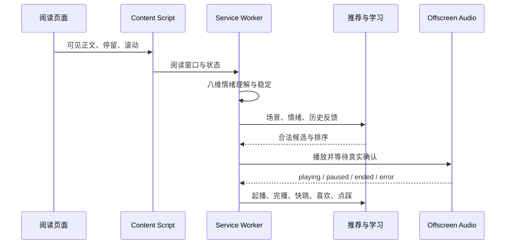

# MBook 产品与工程案例

## 30 秒说明

MBook 是一个 AI 驱动的阅读 BGM Chrome 扩展。它判断用户是否正在专注阅读，理解当前可见内容的八维情绪，从本地或个人曲库选择音乐，并根据喜欢、点踩、快跳和完播持续调整推荐。

这个项目验证的不是“能否播放音乐”，而是三个更难的问题：

1. 如何在不保存正文的前提下，让音乐跟随阅读内容变化。
2. 如何在 Manifest V3 后台会休眠、音频会跨域失败的条件下保持可靠播放。
3. 如何把主观的“氛围合适”拆成可解释、可测试、可学习的推荐链路。

## 产品问题

普通阅读歌单有两个断点：

- 用户需要离开阅读场景手动选歌，打断注意力。
- 固定歌单不知道当前内容从平静转向紧张，也不知道用户是否已经停止阅读。

MBook 的产品假设是：**只在确认专注阅读时自动播放，并让音乐变化落后于稳定的内容情绪变化，可以减少操作，同时避免频繁切歌造成新的干扰。**

因此，成功标准不是单次情绪分类准确率，而是完整体验：

- 进入专注状态后能可靠起播。
- 情绪短暂波动不会立即切歌。
- 离开阅读场景后自动暂停，回来后能恢复。
- 用户手动暂停永远不会被自动逻辑覆盖。
- 每次推荐都能解释来源，并能从反馈继续学习。

## 方案取舍

| 决策 | 备选方案 | 最终选择 | 原因 |
| --- | --- | --- | --- |
| 情绪表达 | 单标签 / 正负面 / 多维向量 | 八维独立分数 | 同一段内容可以同时悲伤且温柔，单标签会丢信息 |
| 文本理解 | 全部调用模型 / 全部词典 | BYOK 模型 + 本地词典回退 | 在质量、成本、隐私和离线可用之间取得平衡 |
| 切歌时机 | 情绪一变就切 / 固定间隔 | 稳定趋势 + 45 秒播放门槛 | 音乐连续性比瞬时响应更重要 |
| 播放状态 | Service Worker 内存 | Offscreen Document 唯一事实源 | 后台休眠后仍能得到真实播放状态 |
| 个性化 | 云端画像 / 固定规则 | 本地逻辑回归 + LinUCB | 不上传正文和反馈，也能逐步探索偏好 |
| 微信读书采集 | 只读 DOM | DOM、页面接口与 Canvas 可见窗口 | Canvas 章节没有可直接选择的正文节点 |

## 系统闭环

## PM 与 RD 边界

**产品定义**

- 专注、浏览、未激活三类状态及其体验语义。
- 手动暂停最高优先级、45 秒切歌门槛、离开 30 秒暂停等业务规则。
- 八维情绪口径、反馈含义和外部服务失败时的降级体验。
- “真实起播”“个人曲库可用”“持久化成功”等验收口径。

**工程实现**

- Content Script、Service Worker、Offscreen Document 的消息协议与状态恢复。
- Canvas 文本快照生命周期、音频 CORS 降级、IndexedDB 迁移与并发取消。
- 五通道召回、42 维特征、逻辑回归和 LinUCB 的实现与测试。
- 自动化测试、浏览器生命周期验证和包体检查。

这条边界避免用“代码已写”代替“用户体验已成立”，也避免让产品需求直接规定不必要的底层实现。

## 关键难题

### 1. 后台休眠与真实播放状态

Manifest V3 的 Service Worker 不常驻。如果只在后台内存保存 `playing=true`，唤醒后 UI 很容易展示假状态。

MBook 将 Offscreen Document 作为播放事实源。后台和 Popup 恢复时重新查询真实状态；新曲只有在媒体元素确认起播后才替换旧曲。手动暂停还会写入持久状态，阻止迟到的自动选歌结果重新播放。

### 2. Canvas 阅读页

微信读书部分页面由 Canvas 绘制，DOM 选择器拿不到章节正文。实现通过观察可见 Canvas 的文字绘制顺序建立短期快照，并校验页面 URL 和 Canvas 标识。清屏、缩放、翻页、页面销毁或快照过期时立即清理，避免旧章节污染新窗口。

### 3. 推荐既要稳定，又要学习

推荐链路先执行版权、时长、可播、人声、黑名单和冷却等硬过滤，再进行五通道召回和八项评分。每次真实起播保存 42 维数值快照，后续反馈才能归因到当时的歌曲和阅读场景。

逻辑回归学习长期偏好，LinUCB 在有限范围内探索未知候选。模型和消费位点都保存在本地，重启后不会重复学习同一事件。

### 4. 包体和音频可靠性

生产包要求小于 10MB。音频以静态 AAC 文件存放，避免代码内联；10 首 CC0 曲目包含完整授权与校验信息。远程流使用共享截止时间、备用地址和原生 Audio 降级，新曲失败时保留旧曲，避免“切歌等于静音”。

## 可复验证据

| 证据 | 当前结果 |
| --- | --- |
| 单元与集成测试 | 27 个文件、178 项通过 |
| TypeScript | `tsc --noEmit` 通过 |
| 生产构建 | WXT 构建通过，产物低于 10MB |
| 浏览器生命周期 | 自动起播、门槛后切歌、自然续播、离开暂停、返回恢复、手动暂停优先 |
| 素材合规 | 10 首 CC0 音乐，来源、修改和 SHA-256 可追溯 |
| 隐私 | 正文不落库，模型密钥不进入网页 Content Script |

本项目尚未正式发布，因此不虚构 DAU、留存或推荐提升数据。当前证据重点是产品闭环、边界条件和可复现的工程质量。

## 已知边界

- 人声密度仍缺少满足包体预算且经过标注验证的检测器。
- 网易云真实三项热度上游数据不可得，目前只能使用明确标注的平台代理值。
- BYOK 协议已测试，但不同模型服务的真实质量仍需分别校准。
- 严格跨源性能和连续一周主观听感尚未完成。

## 下一步验证

1. 用 30-50 首代表性纯音乐校准八维音乐画像，重点观察“悲伤/温柔”和“恐惧/神秘”的区分。
2. 邀请 5-8 名重度阅读用户进行一周试用，记录手动换曲率、快跳率、自动暂停准确率和主观干扰评分。
3. 将演示流程固定为 90 秒：进入文章自动播放、文本情绪变化、门槛后切歌、手动暂停优先、诊断证据。
